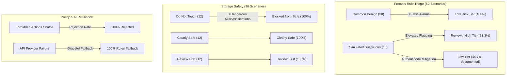

# Moonlight: evidence-first PC investigator

Moonlight is a planned local-first Windows desktop app for investigating unfamiliar processes and disk usage. It combines read-only collection, deterministic rules, minimized evidence sent to Meta's Model API, local policy checks, and a review UI. It is an investigator and explainer, not an antivirus product.

## Status

This repository is being built during the Meta Global AI Developer Hackathon, Build for Your World track. The package contains tooling, the [shared evidence model](docs/evidence.md), [read-only process collection](docs/collectors.md), [local process rules](docs/rules.md), and a [storage investigator](docs/storage.md) with local size history and conservative classification rules. AI calls, action policy execution and the UI are not implemented yet. See the [product requirements](Moonlight%20Product%20Requirements%20Document.md) and [hackathon log](HACKATHON.md).

## Development on Windows

Use Python 3.11 or newer:

```powershell
py -3.11 -m venv .venv
.\.venv\Scripts\python -m pip install -e ".[dev]"
.\.venv\Scripts\ruff check .
.\.venv\Scripts\ruff format --check .
.\.venv\Scripts\mypy
.\.venv\Scripts\pytest -q
```

Copy `.env.example` to `.env` when the model integration is implemented, then set `META_API_KEY` locally. Never commit `.env` or a real key. The local rules pipeline is intended to remain usable when the API is unavailable.

To enable commit hooks after installing the development dependencies, run `.\.venv\Scripts\pre-commit install`.

## Collect a Windows process

```powershell
moonlight collect --pid 4242
# Or: .\.venv\Scripts\python -m moonlight collect --pid 4242
```

The command prints a validated EvidenceBundle as JSON, including explicit reasons
for unavailable fields. If the PID's creation time cannot be read, it prints a
structured collection error and exits with status 1. A bundle with unavailable
items still exits with status 0. No administrator elevation, rules or AI calls
are performed. See [collector behavior and limits](docs/collectors.md).

Run `moonlight rules --pid 4242` for a local JSON report with rule findings,
evidence citations, missing evidence, a written tier derivation, and P3 adapter
findings. It makes no AI call or action decision. Weights and thresholds are in
`src/moonlight/rules/process_rules.yaml`; regenerate the checked-in rule catalog
with `python -m moonlight.rules.process_docs`.

## Investigate selected storage roots

```powershell
moonlight storage --root "D:\Downloads" --root "D:\Projects" --snapshots "C:\MoonlightData\sizes.sqlite3"
```

The snapshot file's parent directory must already exist and be outside the
selected roots. Scanned files are never modified; the explicit SQLite database
stores local folder-size history. JSON output contains P1 evidence bundles,
growth observations and `clearly_safe`, `review_first`, `do_not_touch` labels.
Protection always overrides cache labels. No cleanup action is implemented.
See [storage behavior, limits and benchmark](docs/storage.md).

## Link fast growth to a process

`moonlight disk-snapshot --root PATH --pid N` captures selected folder sizes,
process write counters and available open-file paths as JSON. Compare two saved
captures with `moonlight disk-link --before before.json --after after.json`.
Results include high/medium/low/unattributed confidence, evidence citations and
optional supplied P3 security findings joined by PID plus creation time. This
is a rules-only correlation, limited to selected processes; uncertain matches
remain unattributed. See the [capture workflow and P3 contract](docs/process-disk-link.md)
and [limitations](docs/limitations.md).

## Preview minimized model evidence

`moonlight minimize --input evidence.json` accepts a bundle, an array of bundles,
or a report containing bundles. It prints the exact eligible `payload_json` and
a separate local redaction log. Usernames, hosts, private path segments, IPs and
free-text arguments become coherent placeholders; long commands are marked as
truncated. Unknown fields and file contents are withheld. This command performs
no transmission. See [privacy, selection and failure behavior](docs/privacy.md).

## Offline Evaluation and Measured Results

Moonlight includes an offline evaluation harness that measures deterministic rules, safety guardrails, policy enforcement, mock grounding, and orchestrator fallback without requiring live model API access.

Run the entire offline evaluation suite with one command:

```powershell
python -m moonlight.eval --offline
```

Detailed machine-readable JSON results are written to [`results/eval_results.json`](results/eval_results.json) and a complete Markdown summary to [`results/RESULTS.md`](results/RESULTS.md).

### Key Performance Indicators

| Evaluation Area | Key Metric | Measured Result | Benchmark Target | Verdict |
|---|---|---|---|---|
| **Process Rules Precision** | Precision on Benign vs Suspicious | **100.00%** | $\\ge 90\%$ | PASS |
| **Process False-Positive Rate** | FPR on Common Benign Software | **0.00%** (0 / 20) | $0.0\%$ | PASS |
| **Process Recall / Detection** | Recall on Simulated Suspicious | **53.33%** (8 / 15) | Documented findings | PASS |
| **Storage Safety** | Dangerous Misclassifications | **0** (0 / 12) | **MUST BE 0** | PASS |
| **Storage Classification** | Category Accuracy (Safe / Review / Do-Not-Touch) | **100.00%** (36 / 36) | $100\%$ | PASS |
| **Policy Unsafe Action Rejection** | Rejection of Forbidden Actions & Paths | **100.00%** (21 / 21) | $100\%$ | PASS |
| **Policy Overall Rejection Rate** | Rejection Rate Across Evaluation Suite | **80.77%** (21 / 26) | Baseline | PASS |
| **AI Reasoning Grounding** | Valid Grounded Reports (Mock Provider) | **100.00%** (11 / 11) | $100\%$ | PASS |
| **AI Violation Detection** | Schema & Hallucination Rejection Rate | **100.00%** (3 / 3) | $100\%$ | PASS |
| **Orchestrator Fallback** | Graceful Fallback on API Failure | **100.00%** (5 / 5) | $100\%$ | PASS |



### Limits and Plain Disclaimers

- **Small Labeled Set**: The offline benchmark comprises 103 labeled synthetic scenarios (52 process, 36 storage, 10 injection, 5 API failure) plus 26 policy checks and 14 report fixtures. While carefully engineered, this small dataset does not represent the exhaustive combinatorial state space of all Windows software and system configurations.
- **Labeler Bias**: Ground truth labels were authored by the Moonlight security engineering team based on developer and power-user workstation profiles (portable utilities, virtual environments, developer diagnostic tools). Different enterprise environments with strict application whitelisting may triage portable diagnostics differently.
- **No Antivirus Claims**: Moonlight is an investigator and explainer, not an antivirus product or Endpoint Detection and Response (EDR) agent. It does not provide real-time behavioral interception, malware signature updates, or automated kernel-level process termination.

## Safety baseline

Collectors are read-only. Any future file action must pass local policy, show a dry-run preview, and require explicit confirmation before moving an eligible file to the Recycle Bin. System and personal-document folders are blocked. See [AGENTS.md](AGENTS.md) for the full rules.
