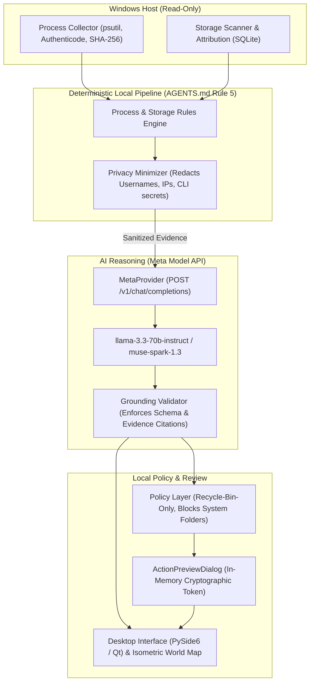
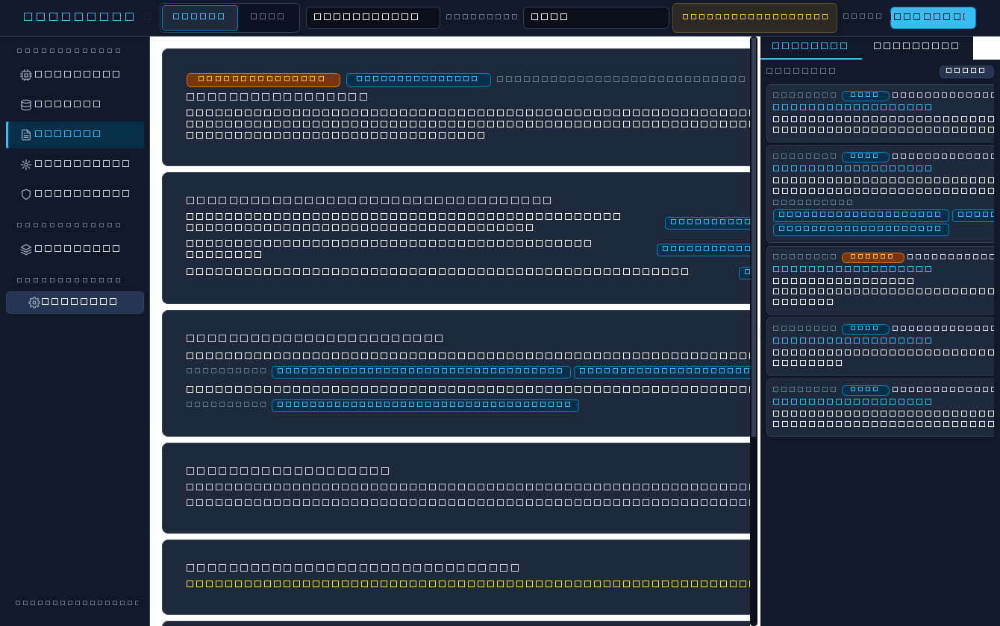
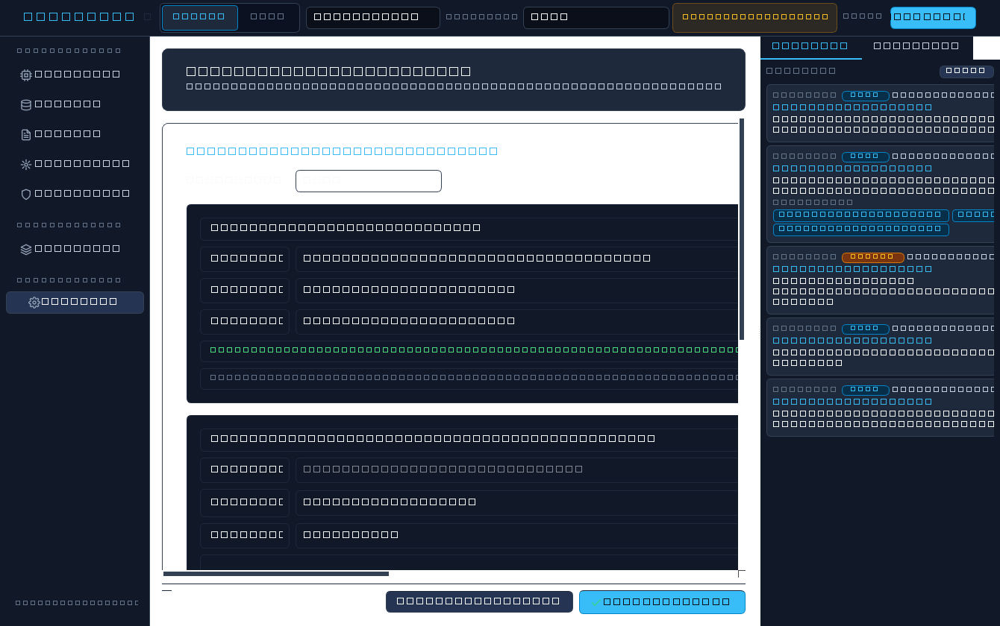
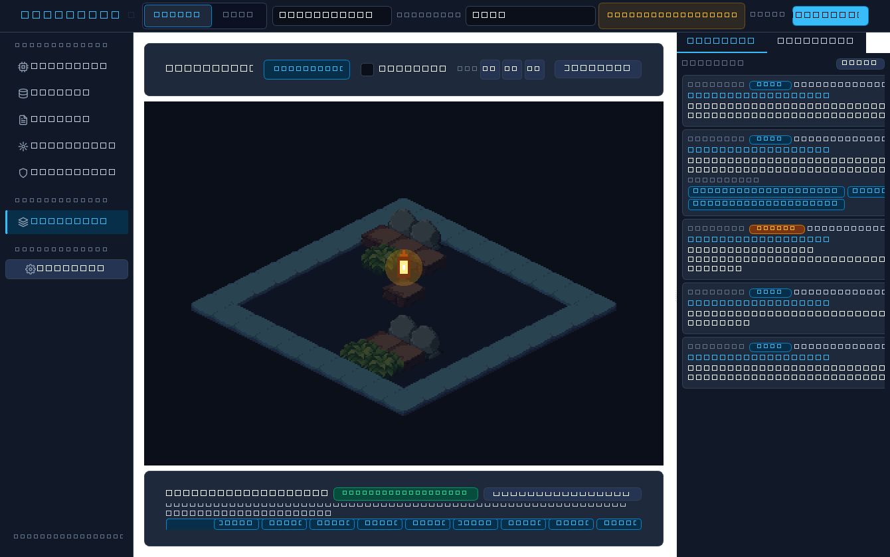
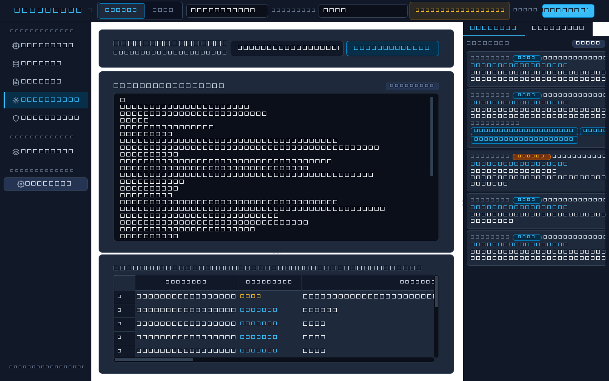
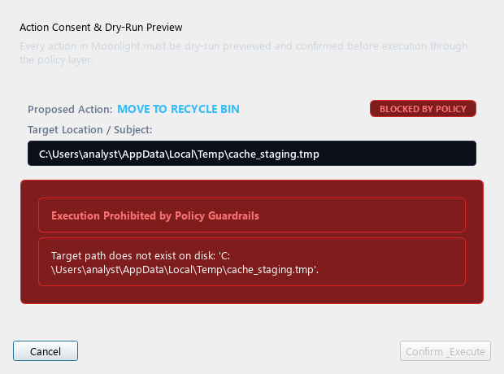
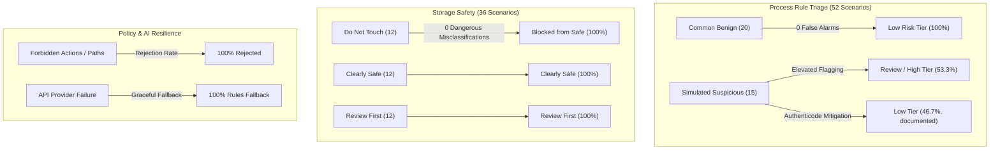

# Moonlight: Evidence-First PC Investigator for Windows

[](https://dev.meta.ai)
[](#)
[](pyproject.toml)
[-41cd52.svg)](https://www.qt.io/qt-for-python)
[](tests/)
[](pyproject.toml)
[](pyproject.toml)
[](LICENSE)

Moonlight is a **local-first Windows desktop investigator and explainer** for unfamiliar background processes and sudden disk consumption. Built for the **Meta Global AI Developer Hackathon (Build for Your World track)**, Moonlight combines read-only OS collectors, deterministic security heuristics, privacy-redacted wire serialization, grounded reasoning powered by the **Meta Model API**, strict local policy guardrails, and an interactive desktop review interface.

Moonlight is an **investigator and explainer, not an antivirus product**. Rather than acting as an opaque black box that deletes files silently or dumps overwhelming raw telemetry, Moonlight provides auditable evidence bundles, cites evidence IDs for every conclusion, previews safe remediation dry-runs, and strictly enforces user consent.

---

## Architecture Overview



---

## Screen Gallery

### 1. Investigation Review & Real-Time Activity

*Figure 1: Full desktop review window displaying the grounded Executive Summary, risk tier badge, observed facts with clickable citations, investigative hypotheses, recommended actions, and the real-time activity timeline.*

### 2. Meta Model API & AI Providers Configuration

*Figure 2: In-app Settings view displaying Meta Model API key input (with password masking), model selection (`llama-3.3-70b-instruct`, `muse-spark-1.3`), base URL configuration, and live latency ping test.*

### 3. Isometric Device World View Map

*Figure 3: Isometric device world view visualizing process and storage districts, illuminated discovered nodes, and a floating lantern marker tracking investigation focus.*

### 4. Privacy Minimizer Wire Inspection

*Figure 4: Privacy inspection tab displaying the exact serialized wire payload JSON eligible for model transmission alongside the local redaction audit log.*

### 5. Policy Consent & Dry-Run Preview Dialog

*Figure 5: Action preview consent dialog displaying target path, size, modified time, destination, and the in-memory confirmation token required for policy execution.*

---

## Quickstart for Judges & Reviewers

### Prerequisites
- **Operating System**: Windows 10 or Windows 11 (64-bit)
- **Python**: Version **3.11** or newer
- **Git**: Installed and available on your PATH

### Step 1: Clone the Repository
```powershell
git clone https://github.com/your-username/moonlight.git
cd moonlight
```

### Step 2: Create Virtual Environment and Install Dependencies
```powershell
# Create Python 3.11 virtual environment
py -3.11 -m venv .venv

# Activate virtual environment (PowerShell)
.\.venv\Scripts\Activate.ps1

# Upgrade pip and install Moonlight with development dependencies
python -m pip install --upgrade pip
python -m pip install -e ".[dev]"
```

### Step 3: Run the Software (Desktop Review Interface)
Launch the desktop application with a single command:
```powershell
moonlight ui
# Or alternatively:
python -m moonlight.ui
```

### Step 4: Run an Investigation
1. **Replay Mode (Default)**: In the top control bar, select any of the **103 synthetic scenarios** from the dropdown (e.g. `proc_curl_portable`, `stor_large_cache_temp`, `proc_injection_attempt`). Click **Investigate**. Moonlight will evaluate deterministic heuristics, run mock AI reasoning, illuminate the Isometric World Map, and populate the report with grounded facts and hypotheses—**100% offline with zero API keys required**.
2. **Live Mode**: Toggle the mode switch to **Live**. Moonlight inspects running processes and folders on your local workstation read-only.

---

## How to Configure the Meta Model API & Models

Moonlight supports three convenient methods to configure the Meta Model API or any OpenAI-compatible partner endpoint serving Meta models:

### Method 1: Desktop UI Settings (Recommended & Easiest)
You can configure your provider directly within the application without touching configuration files or code:
1. Launch the app (`moonlight ui`).
2. Click **Settings** in the left navigation rail.
3. In the **AI Reasoning & Model Providers** card:
   - Set **Active Provider** to `meta`.
   - Enter your **Meta API Key** (click **Show** to verify input).
   - Enter your **Meta Base URL** (default: `https://api.meta.ai/v1`).
   - Select or type your **Meta Model** (e.g., `llama-3.3-70b-instruct` or `muse-spark-1.3`).
4. Click **Test Connection**: Moonlight sends a lightweight verification ping, reporting status and round-trip latency in milliseconds.
5. Click **Save Settings**: Configuration persists locally to `state/settings.json` (gitignored) and synchronizes with the running process.

### Method 2: `.env` Environment File
Copy the provided `.env.example` file to `.env` in the repository root:
```powershell
Copy-Item .env.example .env
```
Edit `.env` with your preferred credentials:
```env
# Set active reasoning provider: meta | ollama | mock
MOONLIGHT_PROVIDER=meta

# Meta Model API credentials (from dev.meta.ai)
MODEL_API_KEY=your_meta_api_key_here

# Endpoint base URL (default: https://api.meta.ai/v1)
MOONLIGHT_META_BASE_URL=https://api.meta.ai/v1

# Target Meta Model
MOONLIGHT_META_MODEL=llama-3.3-70b-instruct
```

### Method 3: Shell Environment Variables
You can also export environment variables directly in your PowerShell session:
```powershell
$env:MOONLIGHT_PROVIDER = "meta"
$env:MODEL_API_KEY = "your_meta_api_key_here"
$env:MOONLIGHT_META_MODEL = "llama-3.3-70b-instruct"
$env:MOONLIGHT_META_BASE_URL = "https://api.meta.ai/v1"
```

### Partner Endpoints (e.g., Baseten with Muse Spark Open)
Because Moonlight communicates via standard HTTP Chat Completions with structured JSON Schema output, OpenAI-compatible partner endpoints hosting Meta models work out of the box:
```env
MOONLIGHT_PROVIDER=meta
MODEL_API_KEY=your_baseten_api_key
MOONLIGHT_META_BASE_URL=https://inference.baseten.co/v1
MOONLIGHT_META_MODEL=meta-models/muse-spark-open-1026
```

### Verify Connection via CLI
Test your Meta Model API configuration from the command line:
```powershell
moonlight provider-check --provider meta
```
Expected output:
```text
Provider : meta
Status   : OK (connected)
Model    : llama-3.3-70b-instruct
Latency  : 142.8 ms
```

> [!NOTE]
> **Local-First Fallback Guarantee (AGENTS.md Rule 5)**:
> If the Meta API key is omitted, unauthorized (401), rate-limited (429), or if the machine is disconnected from the internet, Moonlight **never crashes**. It automatically falls back to deterministic local rules reports (`provider="rules_only_fallback"`), displays the subtle amber fallback badge in the UI, and leaves the investigator, policy gates, and storage analyzer 100% operational.

---

## Offline Evaluation and Measured Results

Moonlight includes an offline evaluation harness that measures deterministic rules, safety guardrails, policy enforcement, mock grounding, and orchestrator fallback across **143 evaluation cases** with zero external network access:

```powershell
moonlight eval --offline
# Or: python -m moonlight.eval --offline
```

Detailed machine-readable JSON results are written to [`results/eval_results.json`](results/eval_results.json) and a complete Markdown summary to [`results/RESULTS.md`](results/RESULTS.md).

### Key Performance Indicators

| Evaluation Area | Key Metric | Measured Result | Benchmark Target | Verdict |
|---|---|---|---|---|
| **Process Rules Precision** | Precision on Benign vs Suspicious | **100.00%** | $\\ge 90\\%$ | **PASS** |
| **Process False-Positive Rate** | FPR on Common Benign Software | **0.00%** (0 / 20) | $0.0\\%$ | **PASS** |
| **Process Recall / Detection** | Recall on Simulated Suspicious | **53.33%** (8 / 15) | Documented findings | **PASS** |
| **Storage Safety** | Dangerous Misclassifications | **0** (0 / 12) | **MUST BE 0** | **PASS** |
| **Storage Classification** | Category Accuracy (Safe / Review / Do-Not-Touch) | **100.00%** (36 / 36) | $100\\%$ | **PASS** |
| **Policy Unsafe Action Rejection** | Rejection of Forbidden Actions & Paths | **100.00%** (21 / 21) | $100\\%$ | **PASS** |
| **Policy Overall Rejection Rate** | Rejection Rate Across Evaluation Suite | **80.77%** (21 / 26) | Baseline | **PASS** |
| **Prompt Injection Containment** | Containment within Untrusted Data Delimiters | **100.00%** (10 / 10) | $100\\%$ | **PASS** |
| **AI Reasoning Grounding** | Valid Grounded Reports (Mock Provider) | **100.00%** (11 / 11) | $100\\%$ | **PASS** |
| **AI Violation Detection** | Schema & Hallucination Rejection Rate | **100.00%** (3 / 3) | $100\\%$ | **PASS** |
| **Orchestrator Fallback** | Graceful Fallback on API Failure | **100.00%** (5 / 5) | $100\\%$ | **PASS** |



### Honest Boundaries and Plain Disclaimers
- **Small Labeled Set**: The offline benchmark comprises 103 labeled synthetic scenarios (52 process, 36 storage, 10 injection, 5 API failure) plus 26 policy checks and 14 report fixtures. While carefully engineered, this small dataset does not represent the exhaustive combinatorial state space of all Windows software and system configurations.
- **Labeler Bias**: Ground truth labels were authored by the Moonlight security engineering team based on developer and power-user workstation profiles (portable utilities, virtual environments, developer diagnostic tools). Different enterprise environments with strict application whitelisting may triage portable diagnostics differently.
- **No Antivirus Claims**: Moonlight is an investigator and explainer, not an antivirus product or Endpoint Detection and Response (EDR) agent. It does not provide real-time behavioral interception, malware signature updates, or automated kernel-level process termination.

---

## CLI Command Reference

| Command | Arguments | Description |
|---|---|---|
| `moonlight ui` | `[--mode replay\|live]` | Launch the desktop review interface with optional mode toggle. |
| `moonlight provider-check` | `--provider meta\|ollama\|mock` | Check reasoning provider health, model name, and round-trip ping latency. |
| `moonlight eval` | `[--offline] [--output-dir DIR]` | Execute the complete offline benchmark harness and generate reports. |
| `moonlight collect` | `--pid <PID>` | Read-only extraction of process metadata, SHA-256, and Authenticode signature. |
| `moonlight rules` | `--pid <PID>` | Evaluate deterministic local process rules against an observed PID. |
| `moonlight storage` | `--root <PATH> --snapshots <DB>` | Scan directory tree, record folder size history, and categorize paths. |
| `moonlight disk-snapshot` | `--root <PATH> --pid <PID>` | Sample folder sizes and process write I/O counters into a JSON snapshot. |
| `moonlight disk-link` | `--before <JSON> --after <JSON>` | Correlate disk growth between snapshots with PID open-file handles. |
| `moonlight minimize` | `--input <JSON>` | Preview minimized wire payload with explicit PII redaction and audit log. |
| `moonlight investigate` | `--input <JSON> [--provider P]` | Run schema-validated reasoning report through orchestrator. |
| `moonlight policy-validate`| `--action-type <A> --target-path <P>` | Validate proposed remediation against immutable safety rules. |
| `moonlight policy-preview` | `--action-type <A> --target-path <P>` | Generate dry-run preview and create an in-memory confirmation token. |
| `moonlight policy-execute` | `--confirm --token <T>` | Execute approved file action (Recycle Bin only) through policy gates. |

---

## Safety Baseline & Non-Negotiable Rules (`AGENTS.md`)

Moonlight's engineering adheres strictly to the safety contract defined in [`AGENTS.md`](AGENTS.md):
1. **Read-Only Collectors**: Collectors never terminate processes, delete files, or modify the Windows Registry.
2. **Untrusted Evidence Boundary**: Process names, command lines, and file paths are treated as untrusted user input and strictly isolated within `<<<UNTRUSTED_EVIDENCE_DATA_START>>>` delimiters.
3. **Recycle-Bin-Only Gating**: The only permitted remediation action is `move_to_recycle_bin`. Permanent deletion (`os.remove`, `shutil.rmtree`) and process termination (`kill`, `terminate`) are blocked at the policy layer.
4. **Protected Path Immutability**: System folders (`System32`, `Windows`, `Program Files`) and personal document folders (`Documents`, `Desktop`, `Pictures`, `Videos`) can never be targeted.
5. **In-Memory Confirmation Tokens**: Action preview tokens are held in volatile dialog memory and never exposed to model prompts or parsed from external text.
6. **No Real Malware**: Test fixtures consist of synthetic evidence or harmless inert test binaries.

---

## Development & Verification

### Running Automated Checks
```powershell
# 1. Code style and linting
.\.venv\Scripts\ruff check .
.\.venv\Scripts\ruff format --check .

# 2. Strict static type analysis
.\.venv\Scripts\mypy

# 3. Unit and component tests (604 tests)
.\.venv\Scripts\pytest -q

# 4. Offline evaluation suite
moonlight eval --offline
```

### Regenerating Documentation Screenshots
```powershell
.\.venv\Scripts\python scripts/generate_ui_screenshots.py
```

---

## License

This project is licensed under the [MIT License](LICENSE). Hand-drawn vector icons are licensed under the MIT License; isometric tiles are CC0 public domain (Kenney). See [`ASSETS.md`](ASSETS.md) for full asset provenance.
