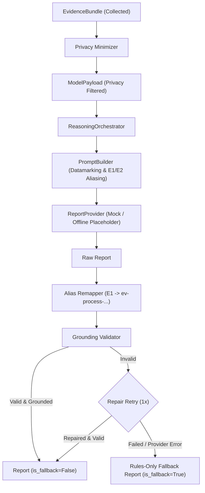

# AI Investigation Report & Reasoning Layer (Offline Scaffold)

Moonlight's reasoning layer produces structured, schema-validated investigation reports from privacy-minimized evidence bundles. In accordance with safety rules, the reasoning pipeline operates with strict local-first safety:
1. **Zero Network Calls in Offline Mode**: Providers that require live network access (`MetaProvider` and `OllamaCloudProvider`) are offline placeholders raising `NotImplementedError`. The offline pipeline runs with `MockProvider`.
2. **Untrusted Evidence Datamarking**: All process names, command lines, file names, and evidence attributes are treated as untrusted input. Evidence items are wrapped in `<UNTRUSTED_EVIDENCE_DATA_START>` data blocks with explicit directives instructing the model never to execute instructions inside evidence.
3. **Short Alias Mapping (E1, E2)**: Evidence items are assigned short aliases in prompt representations, which are mapped back to stable deterministic evidence IDs (`ev-process-...`) to minimize token overhead and prevent hallucinated ID syntax.
4. **Grounding Validation**: Every factual claim and recommendation must cite valid evidence IDs present in the input bundle. Empty observed fact citations and ungrounded IDs are structurally rejected.
5. **Policy Allowlist Enforced**: All recommended actions must strictly match the local policy allowlist (`open_file_location`, `copy_hash_to_clipboard`, `move_to_recycle_bin`, `mark_reviewed`). Dangerous operations such as process termination, process killing, and permanent deletion are structurally blocked.
6. **Deterministic Fallback**: If an AI provider fails, raises an error, or returns ungrounded/malformed reports after 1 repair retry, the orchestrator falls back to deterministic local rules-only results with `is_fallback=True` and a visible `fallback_reason`.

---

## Architecture



---

## Report Schema

The investigation report schema is defined in `moonlight.reasoning.models.Report` and exported as machine-readable JSON Schema at [`docs/report-schema.json`](report-schema.json).

### Fields

| Field | Type | Description |
| --- | --- | --- |
| `summary` | `string` | Executive summary of findings and risk assessment. |
| `risk_tier` | `"low"` \| `"review"` \| `"high"` \| `"inconclusive"` | Overall risk tier. |
| `confidence` | `float` (0.0 – 1.0) | Calibrated confidence in the assessed risk tier. |
| `observed_facts` | `list[ObservedFact]` | Factual claims, each citing >= 1 valid evidence ID. |
| `hypotheses` | `list[Hypothesis]` | Plausible explanations of behavior with likelihood ratings. |
| `benign_explanations` | `list[string]` | Legitimate explanations mitigating false positives. |
| `missing_evidence` | `list[string]` | Missing or unavailable evidence items/queries. |
| `recommended_actions` | `list[RecommendedAction]` | Allowed remediation steps from the policy allowlist. |
| `uncertainty_notes` | `string` | Known caveats, limitations, or ambiguities. |
| `metadata` | `ReportMetadata` | Provenance: `provider`, `model`, `prompt_version`, `timestamp`. |
| `is_fallback` | `bool` | Visible flag indicating whether local rules-only fallback occurred. |
| `fallback_reason` | `string` \| `null` | Detailed reason for fallback activation, if applicable. |

---

## CLI Usage

Run investigation reasoning from the CLI:

```bash
# Run investigation using the offline mock provider:
moonlight investigate --input "C:/MoonlightData/bundle.json" --provider mock

# Test offline fallback with MetaProvider placeholder:
moonlight investigate --input "C:/MoonlightData/bundle.json" --provider meta
```
