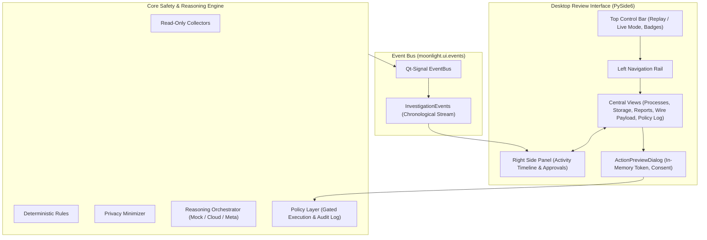
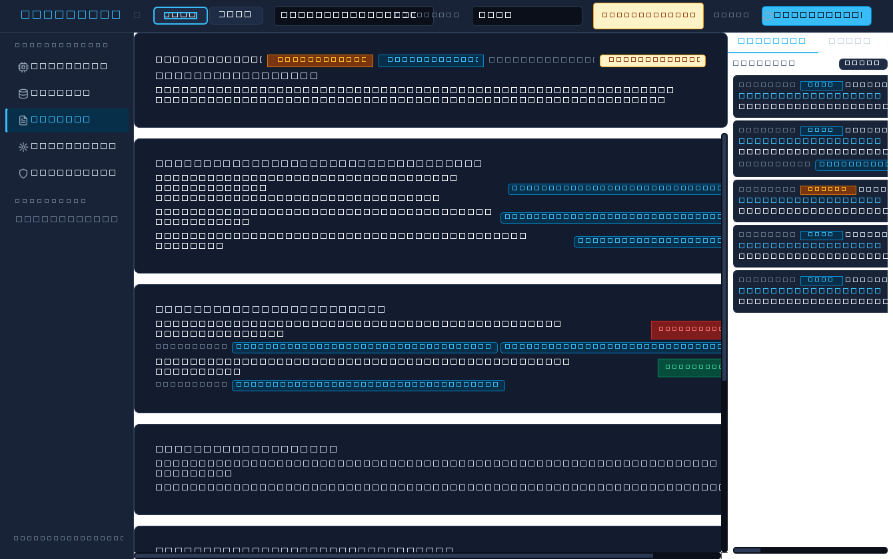
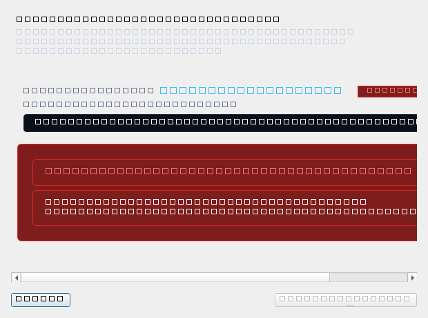
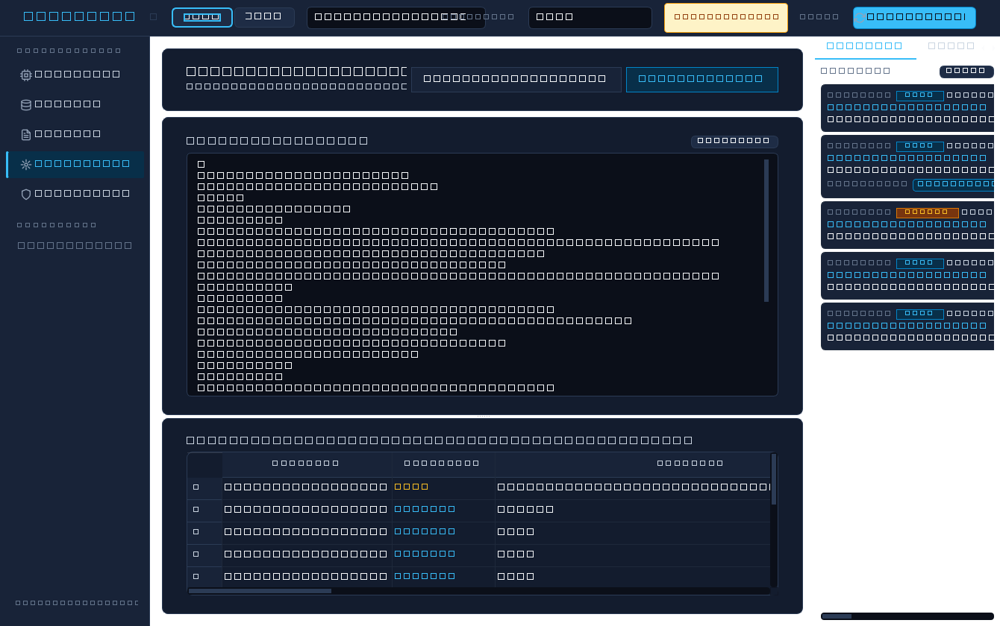

# Moonlight Review Interface & UI Architecture

Moonlight features a modern, accessible desktop review interface built with **PySide6 (Qt for Python)**. Designed specifically for security analysts and camera-ready demos, it emphasizes visual clarity, immutable auditability, and safety guardrails.

---

## Architecture Overview



---

## Visual Design System & Theme

Moonlight's visual presentation is driven by a bespoke design token system in [`moonlight.ui.theme`](../src/moonlight/ui/theme.py), producing a unified Qt Style Sheet (QSS):

1. **Moonlit Dark Palette**: Deep midnight blue-black canvas (`#0b0f19`), layered card surfaces (`#131c2e`, `#182338`), subtle structural dividers (`#1e293b`), and a cool sky accent (`#38bdf8`).
2. **8px Spacing Grid**: Rigorous geometric scaling (`xs: 4px`, `sm: 8px`, `md: 16px`, `lg: 24px`, `xl: 32px`).
3. **Windows System Font Stack**: Native type rendering with fallback support (`Segoe UI`, `-apple-system`, `system-ui`, `sans-serif`).
4. **Status Chips with Text + Color**: Risk tiers and confidence scores always present explicit textual labels alongside their semantic color badge (e.g. `[LOW RISK]`, `[REVIEW REQUIRED]`, `[HIGH RISK]`, `[INCONCLUSIVE]`, `[CONFIDENCE: 92%]`), never relying on color alone.
5. **High-Contrast Focus Outlines**: Full keyboard accessibility with visible `:focus` states throughout all buttons, tables, text areas, and navigation pills.
6. **Hand-Drawn Vector Icons**: All icons are custom, clean SVGs authored in [`src/moonlight/ui/icons/`](../src/moonlight/ui/icons/) under the project's MIT License (see [`ASSETS.md`](../ASSETS.md)).

---

## Screen Gallery

### 1. Investigation Review & Activity Timeline

*Figure 1: Full desktop review window displaying the Executive Summary, grounded observed facts with clickable citations, investigative hypotheses with likelihood ratings, top bar mode controls, and the real-time activity timeline.*

### 2. Action Consent & Dry-Run Preview Dialog

*Figure 2: Dry-run preview consent dialog displaying target path, size, modified time, destination, and the in-memory confirmation token required for policy execution.*

### 3. Sent to the Model Wire Inspection

*Figure 3: Privacy inspection tab displaying the exact serialized wire payload JSON alongside the local redaction audit log.*

---

## Layout and Panels

The interface is structured into four primary layout regions:

### 1. Left Navigation Rail
Provides one-click switching between investigation views:
- **Processes**: Complete inventory of observed processes, digital signatures, hashes, command lines, and rule findings.
- **Storage**: Evaluated storage paths, size totals, and policy safety categories (`clearly_safe`, `review_first`, `do_not_touch`).
- **Reports**: Executive summary, risk tier, confidence, separated facts vs hypotheses, benign explanations, missing evidence, uncertainty notes, and recommended actions.
- **Sent to the model**: The exact minimized payload JSON eligible for model use and the local redaction log.
- **Policy log**: Append-only local audit log recording every policy verification, preview, and execution decision.
- *Extensible Extension Slot*: Pre-configured placeholder for optional future World View integration.

### 2. Top Control Bar
- **Replay / Live Mode Toggle**: Replay mode (default) evaluates reproducible labeled scenarios; Live mode runs read-only local machine collection.
- **Scenario Selector**: Dropdown to inspect any of the 103 synthetic scenarios from `fixtures/scenarios/`.
- **Provider Selector**: Selects between `mock`, `ollama-cloud`, and `meta`.
- **Provider Transparency Badge**: Automatically renders the `'cloud placeholder model'` badge whenever the provider is not `'meta'`.
- **Investigate Button**: Launches background worker thread.

### 3. Central Content Area
A high-performance `QStackedWidget` hosting the active investigation panel, with automatic view transitions when citations are clicked.

### 4. Right Side Panel
- **Activity Tab**: Real-time chronological timeline rendering `InvestigationEvent` telemetry emitted across the pipeline.
- **Approvals Tab**: Interactive queue of pending action recommendations with policy status chips and dry-run preview triggers.

---

## Safety Guarantees & Consent Flow

In strict compliance with `AGENTS.md` rules:

1. **Read-Only Collectors**: Collectors never terminate processes, delete files, or modify the system registry.
2. **In-Memory Confirmation Tokens**: The cryptographic `confirmation_token` generated by `preview_action` is stored strictly in dialog memory. It is never included in prompt templates, never transmitted to external APIs, and never parsed from model output.
3. **No Direct OS Invocations**: UI code never calls `os.system`, `subprocess`, or file deletion primitives. `open_file_location` strictly invokes the policy layer's argument-safe launcher (`launch_file_location`), and `move_to_recycle_bin` strictly routes through `send2trash` via `execute_action`.
4. **Extra Confirmation for Review-First Paths**: Items classified as `review_first` require explicitly checking a secondary acknowledgment checkbox before the `Confirm & Execute` button is enabled.
5. **Air-Gapped Default in Live Mode**: Live mode defaults to the offline mock provider so zero endpoint data leaves the workstation. Switching to an external provider requires explicit confirmation via `LiveProviderWarningDialog`.
6. **Thread Safety**: All long-running operations execute inside background `QThread` workers, ensuring the UI remains responsive and free from lockups.

---

## Interactive Citation Click-Through

Every observed fact and hypothesis in the report displays clickable citation chips (e.g. `[ev-process-executable_path-...]` or `[E1]`). Clicking any citation chip:
1. Automatically navigates the central stacked widget to the appropriate view (`ProcessesViewWidget` for process evidence; `StorageViewWidget` for disk findings).
2. Scrolls the table to the exact row matching the citation ID.
3. Selects and highlights the row for immediate inspection.

---

## Headless Testing and Offscreen Verification

All UI components and dialogs are verified via automated headless pytest suites using Qt's `offscreen` platform plugin (`os.environ["QT_QPA_PLATFORM"] = "offscreen"`):

```powershell
# Run UI component and window integration tests:
.venv\Scripts\pytest.exe tests/test_ui_window.py tests/test_ui_dialogs.py tests/test_ui_badge.py

# Regenerate offscreen screenshots:
.venv\Scripts\python.exe scripts/generate_ui_screenshots.py
```
